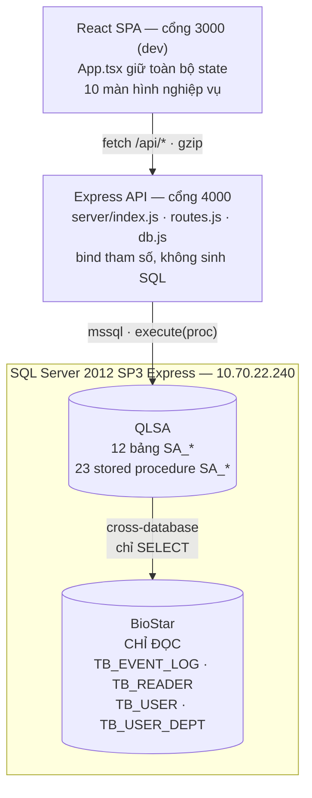

# Phân Tích Hệ Thống Quản Lý và Theo Dõi Suất Ăn

> Tài liệu phân tích hiện trạng — **chỉ đọc mã nguồn, không sửa đổi bất kỳ file code nào**.
> Ngày phân tích: 05/08/2026 · Số liệu kiểm chứng trực tiếp trên SQL Server `10.70.22.240`.

---

## 1. Tóm tắt điều hành

Hệ thống là ứng dụng web quản lý suất ăn nhà ăn nhà máy, hoạt động trên **dữ liệu chấm thẻ thật** từ hệ thống BioStar. Kiến trúc 3 tầng: React SPA → Express API → SQL Server stored procedure.

| Hạng mục | Hiện trạng |
|---|---|
| Tầng dữ liệu | 12 bảng `SA_*` + 23 stored procedure trong DB `QLSA`, đọc cross-database sang `BioStar` |
| Tầng API | Express, 24 endpoint, mỗi endpoint bọc đúng 1 stored procedure |
| Tầng giao diện | React 19 + Vite + Tailwind v4, 10 màn hình |
| Quy mô dữ liệu | `TB_EVENT_LOG` ~9,67 triệu dòng; riêng 3 máy nhà ăn ~3,37 triệu dòng |
| Thông lượng | ~49.500 lượt quẹt/tháng, ~917 nhân viên hoạt động/tháng |
| Kiểm tra tự động | Chỉ có `tsc --noEmit`. **Không có unit test, không có CI** |

**Đánh giá chung:** phần lõi tính toán (phân ca, ngày công, ánh xạ bộ phận, đơn giá) đã được đẩy xuống SQL và kiểm chứng đúng trên dữ liệu thật. Rủi ro tập trung ở **tầng giao diện**: một lỗi nhãn hiển thị đã xác nhận, một số quy tắc bị hard-code lặp lại, và vấn đề hiệu năng khi render bảng lớn.

---

## 2. Kiến trúc tổng thể



### Nguyên tắc thiết kế đang được tuân thủ

1. **Không viết SQL trong JavaScript.** Mọi truy vấn nằm trong `db/03_procedures.sql`. Tầng API chỉ validate tham số rồi `execute` procedure → không có bề mặt SQL injection.
2. **`BioStar` là chỉ đọc.** Không có câu lệnh ghi nào trỏ vào `BioStar`. Dữ liệu chấm thẻ gốc được bảo toàn tuyệt đối.
3. **Script SQL là nguồn sự thật của schema.** 3 file trong `db/` chạy lại được nhiều lần (idempotent).
4. **`App.tsx` là chủ sở hữu duy nhất của state.** Các view không tự gọi API, chỉ nhận `data` + callback `onSave`/`onDelete`.

---

## 3. Tầng dữ liệu

### 3.1. Phân chia database

| Database | Vai trò | Quyền |
|---|---|---|
| `BioStar` | Dữ liệu gốc từ hệ thống chấm thẻ | **Chỉ đọc** |
| `QLSA` | Cấu hình + logic của hệ thống suất ăn | Đọc/ghi |

Chuỗi kết nối trỏ vào `QLSA`; các procedure trong `QLSA` tự đọc sang `BioStar.dbo.*`. Cách này giữ đúng yêu cầu ban đầu (Initial Catalog = QLSA) mà không cần linked server.

### 3.2. Danh sách 12 bảng `SA_*`

| Nhóm | Bảng | Nội dung |
|---|---|---|
| Danh mục tổ chức | `SA_LargeDepartment` | 10 bộ phận lớn |
| | `SA_DepartmentMapping` | 41 ánh xạ bộ phận nhỏ → lớn |
| | `SA_DepartmentMappingRule` | Ánh xạ **có điều kiện** theo tên nhân viên |
| Danh mục vận hành | `SA_Shift` | 6 ca ăn + cờ `WrapsMidnight` |
| | `SA_Reader` | 3 máy chấm ăn + cờ `IsKoreanMachine` |
| | `SA_MealEventCode` | 17 mã sự kiện BioStar hợp lệ |
| | `SA_MealPrice` | 7 đơn giá suất ăn |
| Nghiệp vụ | `SA_MilkEntry` | Nhập sữa hằng ngày |
| | `SA_BirthdayConfig` | Ngày sinh nhật tập thể |
| | `SA_ManualEntry` | Nhập bổ sung suất ăn thủ công |
| Cấu hình | `SA_SystemSetting` | `LABOR_COST`, `ABNORMAL_MIN_PUNCH` |
| | `SA_MonthlyCost` | Số liệu biểu đồ xu hướng năm |

### 3.3. Stored procedure trọng yếu — `SA_MealLog_GetByRange`

Đây là trái tim hệ thống. Toàn bộ 6/10 màn hình đều ăn dữ liệu từ procedure này.

**Chuỗi xử lý:**

```
Tham số @FromDate/@ToDate (ngày công)
   ↓ đổi sang khoảng epoch  →  seek clustered index PK(nDateTime,...)
Lọc 3 máy (SA_Reader) + 17 mã sự kiện (SA_MealEventCode)
   ↓
Ghép nhân viên: TRY_CAST(sUserID AS int) = nUserID  →  bảng tạm #Users
   ↓ khử trùng lặp bằng ROW_NUMBER()
Giải bộ phận lớn: rule có điều kiện > ánh xạ mặc định > 'Khác'
   ↓
Tính actualDate = ngày của (thời điểm quẹt − 6601 giây)
Tính shiftCode  = OUTER APPLY TOP 1 trên SA_Shift theo SortOrder
   ↓
Trả về ~50.000 dòng đã định dạng sẵn char(10)/char(8)/char(19)
```

**Ba điểm kỹ thuật đáng ghi nhận:**

- **Tối ưu index.** `nDateTime` là cột đầu của clustered PK. Procedure quy đổi khoảng ngày công sang khoảng epoch *trước khi* lọc, nên SQL Server seek thay vì scan 3,37 triệu dòng. Nếu lọc bằng `CONVERT(date, DATEADD(...)) BETWEEN ...` như hệ thống cũ `PKG_TKSA001@GET_LIST` thì sẽ full scan.
- **Hằng số 6601 giây.** `6601 = 01:50:01`. Trừ đi rồi lấy phần ngày cho kết quả: quẹt lúc `01:50:00` → lùi về hôm trước, `01:50:01` → giữ nguyên ngày. Đã kiểm chứng đúng ranh giới.
- **Phân ca hướng dữ liệu.** Cờ `WrapsMidnight` chuyển điều kiện từ `AND` sang `OR`, xử lý được ca CA1 vắt qua nửa đêm mà không cần code riêng cho CA1.

### 3.4. Quy tắc ánh xạ có điều kiện

Bảng `SA_DepartmentMappingRule` cài đặt yêu cầu nghiệp vụ đặc thù:

> *Khách công tác có tên chứa `Business` → bộ phận lớn `KR`; không chứa → `SP`.*

Thứ tự ưu tiên: **rule → ánh xạ mặc định → `Khác`**. Nhánh `SP` là ánh xạ mặc định nên chỉ cần 1 rule cho nhánh `KR`.

Kiểm chứng tháng 7/2026: **33 khách → `KR`**, **3 khách → `SP`**. Đúng đặc tả.

---

## 4. Tầng API

24 endpoint, tất cả đều là lớp bọc mỏng quanh stored procedure.

| Nhóm | Endpoint | Ghi chú |
|---|---|---|
| Hệ thống | `GET /api/health` | Kiểm tra kết nối DB |
| Khởi động | `GET /api/bootstrap` | Gộp 7 result set trong 1 lượt gọi |
| Dữ liệu chính | `GET /api/meal-logs?from=&to=` | ~50.000 dòng/tháng |
| Ánh xạ | `GET/POST /api/mappings`, `DELETE /api/mappings/:x` | |
| | `GET /api/departments/small` | Kèm cờ `isMapped` để phát hiện bộ phận chưa ánh xạ |
| Nghiệp vụ | `/api/milk`, `/api/birthday`, `/api/manual-entries` | GET/POST/DELETE |
| Danh mục | `/api/shifts`, `/api/readers`, `/api/prices`, `/api/monthly-costs` | |
| Cấu hình | `GET /api/settings`, `PUT /api/settings/:key` | |

### Điểm mạnh

- **Validate tập trung.** Các hàm `parseDate`, `parseInteger`, `parseNumber`, `parseText` chặn dữ liệu sai ngay tại biên, trả HTTP 400 kèm thông điệp tiếng Việt.
- **Ngày truyền dưới dạng chuỗi `YYYY-MM-DD`**, bind `sql.VarChar(10)` chứ không bind đối tượng `Date`. Tránh được lỗi lệch múi giờ ±1 ngày — một lỗi rất phổ biến và rất khó phát hiện trong hệ thống chấm công.
- **Nén gzip.** Payload 1 tháng giảm từ **15,1 MB → 1,18 MB** (tỉ lệ ~12,8×). Đây là yếu tố khiến kiến trúc "tính toán phía client" còn khả thi.
- **Thông điệp lỗi từ `RAISERROR` trong procedure truyền thẳng lên giao diện**, giữ nguyên tiếng Việt.

---

## 5. Tầng giao diện — 10 màn hình

| # | Tab | Nguồn dữ liệu | Ghi/Sửa |
|---|---|---|---|
| 1 | Dashboard | `logs`, `readers`, `shifts` | — |
| 2 | Lịch Sử Chấm Ăn | `logs` + pivot | — |
| 3 | Thống Kê Ca / Bộ Phận | `logs` + `mappings` | — |
| 4 | Ánh Xạ Bộ Phận | `mappings` | ✅ Ghi DB |
| 5 | Hàn Quốc vs Việt Nam | `logs` | — |
| 6 | Chấm Ăn > 3 Lần | `logs` | — |
| 7 | Cấu Hình Sinh Nhật | `birthdayConfigs` | ✅ Ghi DB |
| 8 | Nhập Thủ Công Ca | `manualEntries` | ✅ Ghi DB |
| 9 | Quản Lý Sữa | `milkEntries` | ✅ Ghi DB |
| 10 | Báo Cáo Chi Phí | tổng hợp tất cả | — |

**Mô hình dữ liệu:** `App.tsx` gọi API 1 lần khi khởi động (danh mục) và gọi lại `meal-logs` mỗi khi đổi khoảng ngày. Các view nhận `logs` thô rồi tự `useMemo` lọc và tổng hợp. Việc lặp lại phép tổng hợp giữa các view là **quy ước có chủ đích** của dự án, không phải lỗi.

---

## 6. Quy tắc nghiệp vụ cốt lõi

| Quy tắc | Cài đặt | Trạng thái |
|---|---|---|
| Ngày công 08:00 → 08:00; quẹt ≤ `01:50:00` thuộc hôm trước | `DATEADD(SECOND, -6601, LogTime)` | ✅ Đã kiểm chứng đúng ranh giới |
| 6 ca theo khung giờ, CA1 vắt nửa đêm | `SA_Shift` + `WrapsMidnight` | ✅ |
| 3 máy chấm; TA-102 = máy Hàn → đơn giá 65K | `SA_Reader.IsKoreanMachine` | ✅ |
| Ánh xạ bộ phận 2 cấp, chưa khớp → `Khác` | `SA_DepartmentMapping` | ✅ |
| Khách công tác chứa `Business` → `KR` | `SA_DepartmentMappingRule` | ✅ |
| Bất thường = quẹt > 3 lần/ngày công | `getAbnormalPunches()` phía client | ⚠️ Xem mục 8.4 |
| Đơn giá lấy theo `code`, có giá trị dự phòng | `getUnitPrice(code, fallback)` | ⚠️ Chỉ áp dụng ở màn Báo Cáo Chi Phí |

---

## 7. Số liệu thực tế — Tháng 7/2026

### 7.1. Tổng quan

| Chỉ số | Giá trị |
|---|---|
| Tổng lượt quẹt hợp lệ | **49.462** |
| Số nhân viên có phát sinh | **917** |
| Lượt quẹt tại máy Hàn (TA-102) | 408 |
| Số dòng tổng hợp ngày×người | **21.335** |

### 7.2. Phân bố theo ca

| Ca | Khung giờ | Số suất | Tỉ trọng |
|---|---|---:|---:|
| CA4 (Bữa Trưa) | 10:40 – 13:30 | 11.036 | 22,3% |
| CA5 (Bữa Chiều) | 16:30 – 18:40 | 9.007 | 18,2% |
| CA3 (Bữa Sáng) | 06:45 – 08:10 | 8.186 | 16,6% |
| CA1 (Ca Đêm) | 22:50 – 01:50 | 7.697 | 15,6% |
| CA2 (Sáng Sớm) | 04:30 – 06:30 | 7.266 | 14,7% |
| CA6 (Tăng Ca Tối) | 18:45 – 20:10 | 6.078 | 12,3% |
| Khác (ngoài ca) | — | 192 | 0,4% |

> Tỉ lệ "Khác" chỉ **0,4%** cho thấy 6 khung giờ ca đang phủ gần như trọn vẹn thực tế vận hành.

### 7.3. Phân bố theo bộ phận lớn

| Bộ phận lớn | Số suất | Tỉ trọng |
|---|---:|---:|
| CSP | 14.924 | 30,2% |
| QC | 7.303 | 14,8% |
| WLP2 | 6.564 | 13,3% |
| LFEM | 5.510 | 11,1% |
| SP | 5.139 | 10,4% |
| SMT | 4.501 | 9,1% |
| WLP1 | 4.084 | 8,3% |
| R&D | 713 | 1,4% |
| KR | 669 | 1,4% |
| **Khác (chưa ánh xạ)** | **55** | **0,1%** |

> Chất lượng ánh xạ rất tốt: chỉ **55/49.462 dòng (0,11%)** rơi vào `Khác`.

### 7.4. Phân bố số lần quẹt trong một ngày công

| Số lần quẹt | Số trường hợp | Đánh giá |
|---:|---:|---|
| 1 | 4.425 | Bình thường |
| 2 | 6.884 | Bình thường |
| 3 | 9.199 | Bình thường (sáng + trưa + chiều) |
| 4 | 614 | ⚠️ Vượt ngưỡng |
| 5 | 137 | ⚠️ |
| 6 | 28 | ⚠️ |
| 7 | 21 | ⚠️ |
| 8 | 27 | 🔴 Cần điều tra |
| **Tổng vượt ngưỡng** | **827** | **3,9% số ngày-người** |

---

## 8. Phát hiện và rủi ro

### 8.1. 🔴 NGHIÊM TRỌNG — Nhãn 2 máy chấm bị hoán đổi trên Dashboard

**Vị trí:** `src/components/DashboardView.tsx`, dòng 51–53 và 117–191.

Dashboard truy cập mảng máy chấm **theo vị trí** (`readers[0]`, `readers[1]`, `readers[2]`) nhưng gắn **nhãn cứng** cho từng vị trí. Procedure `SA_Reader_Get` sắp xếp `ORDER BY ReaderCode`, cho thứ tự:

| Vị trí | Máy thực tế | Nhãn đang hiển thị | Kết quả |
|---|---|---|---|
| `readers[0]` | TA-102 (CT Korea) | "TA-102 **- Canteen K**" | ❌ Sai |
| `readers[1]` | TA-103 (CanteenV) | "TA-103 - Canteen V" | ✅ Đúng |
| `readers[2]` | TA-104 (CanteenK) | "TA-104 **- CT Korea**" + nhãn đỏ "Người Hàn" | ❌ Sai |

**Hậu quả cụ thể:** thẻ thứ 3 trên Dashboard ghi *"Suất ăn chuyên gia Hàn"* nhưng thực chất đang đếm lượt quẹt của **TA-104 – Canteen K** (con số lớn, hàng chục nghìn), trong khi số suất ăn người Hàn thật chỉ là 408. Người xem Dashboard sẽ hiểu sai nghiêm trọng về chi phí suất ăn chuyên gia.

**Lưu ý:** ô chỉ số "Suất Ăn Người Hàn" ở hàng dưới (dùng `l.isKorean`) vẫn **đúng**. Chỉ 3 thẻ máy chấm ở trên bị sai. Đây là điểm khiến lỗi khó phát hiện — cùng một màn hình có chỗ đúng chỗ sai.

**Nguyên nhân gốc:** dữ liệu mock cũ xếp mảng theo thứ tự `[TA-104, TA-103, TA-102]`, còn API xếp theo mã máy `[TA-102, TA-103, TA-104]`. Code phụ thuộc vị trí mảng nên đảo nhãn.

---

### 8.2. 🟠 CAO — Render bảng lớn không phân trang

**Vị trí:** `MealHistoryView.tsx` (chế độ Pivot và Chi Tiết), `DepartmentReportView.tsx` (modal chi tiết).

Các bảng render **toàn bộ** kết quả vào DOM, không phân trang, không ảo hoá:

| Màn hình | Số dòng DOM với dữ liệu 1 tháng |
|---|---:|
| Lịch Sử — chế độ Chi Tiết | **49.462 dòng** |
| Lịch Sử — chế độ Pivot | **21.335 dòng** |
| Thống Kê — modal "Chi tiết" bộ phận CSP | **14.924 dòng** |

Với dữ liệu mock cũ (~600 dòng) điều này vô hại. Với dữ liệu thật, mỗi lần đổi bộ lọc trình duyệt phải dựng lại hàng chục nghìn phần tử — dự kiến treo giao diện vài giây, và có thể không mở nổi modal của bộ phận lớn.

---

### 8.3. 🟠 CAO — Đơn giá bị hard-code ở màn "Hàn Quốc vs Việt Nam"

**Vị trí:** `KoreanVsVietnameseView.tsx`, dòng 50–51 và 104, 173.

```
const koreanEstimatedCost     = koreanStats.total * 65000;
const vietnameseEstimatedCost = vietnameseStats.total * 28000;
```

Màn hình này **không nhận** `priceItems` từ DB mà ghi cứng 65.000 / 28.000. Trong khi đó màn "Báo Cáo Chi Phí" đã đọc đơn giá từ `SA_MealPrice`.

**Hậu quả:** khi kế toán cập nhật đơn giá trong `SA_MealPrice`, hai màn hình sẽ cho **hai con số tiền khác nhau** trên cùng một tập dữ liệu. Rủi ro tranh cãi số liệu khi đối chiếu báo cáo.

Ngoài ra dòng 24 và 28 ghi cứng `readerId === 547244627` — trùng lặp thông tin đã có ở `SA_Reader.IsKoreanMachine`.

---

### 8.4. 🟡 TRUNG BÌNH — Ngưỡng cảnh báo "> 3 lần" tạo 827 cảnh báo/tháng

Badge đỏ trên thanh điều hướng sẽ hiển thị **827**. Đây **không phải lỗi kỹ thuật** — con số phản ánh đúng dữ liệu thật. Nhưng cần quyết định về mặt nghiệp vụ:

- 827 trường hợp = **3,9%** tổng số ngày-người → đây là **hàng đợi rà soát**, không phải cảnh báo ngoại lệ hiếm gặp.
- Phân bố cho thấy ngưỡng 3 là hợp lý: nhóm 3 lần/ngày có 9.199 trường hợp (ăn đủ 3 bữa, bình thường), rồi **rơi vực xuống 614** ở mức 4 lần. Ranh giới tự nhiên của dữ liệu đúng nằm giữa 3 và 4.
- Đáng chú ý: **27 trường hợp quẹt 8 lần/ngày** — nhóm này nên được điều tra trước tiên vì khó giải thích bằng nhu cầu ăn uống thông thường.

Ngưỡng đã được đưa vào `SA_SystemSetting.ABNORMAL_MIN_PUNCH`, nhưng **giao diện hiện chưa đọc tham số này** — vẫn dùng hằng số `3` trong `getAbnormalPunches()`.

---

### 8.5. 🟡 TRUNG BÌNH — Quy ước tính tiền cho bộ phận `KR`

**Vị trí:** `FinancialReportView.tsx`, dòng 88–89.

```
const krLogs = deptLogs.filter((l) => l.isKorean || deptName === 'KR');
```

Với bộ phận `KR`, **mọi** lượt quẹt đều tính đơn giá cơm Hàn 65K, kể cả khi quẹt tại nhà ăn Việt Nam.

Số liệu tháng 7/2026:

| Trường hợp | Số lượt | Đơn giá áp dụng |
|---|---:|---|
| Thuộc `KR`, quẹt tại **máy Hàn** | 391 | 65K ✅ |
| Thuộc `KR`, quẹt tại **máy Việt** | **278** | 65K ⚠️ |
| Thuộc `SP`, quẹt tại **máy Hàn** | 17 | 65K ✅ |

**278 lượt** (~18,1 triệu VNĐ chênh lệch so với đơn giá 28K) phụ thuộc hoàn toàn vào quy ước này. Đây có thể là **chính sách đúng** (chuyên gia Hàn luôn hưởng định mức Hàn), nhưng cần được xác nhận bằng văn bản vì ảnh hưởng trực tiếp đến số tiền quyết toán.

Quy tắc `Business → KR` mới bổ sung làm tăng ảnh hưởng của quy ước này, vì 33 khách công tác nay cũng thuộc `KR`.

---

### 8.6. 🟡 TRUNG BÌNH — 29 bộ phận nhỏ chưa được ánh xạ

Ảnh ánh xạ nghiệp vụ liệt kê 41 bộ phận, nhưng `BioStar.TB_USER_DEPT` có nhiều hơn. 29 bộ phận đang rơi vào `Khác`, trong đó có những bộ phận đông người:

| Bộ phận chưa ánh xạ | Số nhân viên | Có phát sinh chấm ăn T7? |
|---|---:|---|
| `IOT` | 93 | Không |
| `Customer` | 58 | Không |
| `Nghi Viec` | 45 | Không |
| `co the` | 31 | Không |
| `Card Specialist` | 22 | Không |
| `Nha bep moi` | 17 | Không |
| `The nha an` | 14 | ✅ 1 lượt |
| `FOSECA` | 13 | Không |
| `Lai Xe` / `Bao ve Tistco` / `Y Te` … | 7–12 | `Y Te`: ✅ 53 lượt |

Hiện tại tác động nhỏ (55 lượt/tháng), nhưng nếu các bộ phận này bắt đầu chấm ăn thì chi phí sẽ dồn vào nhóm `Khác` và không phân bổ được. **Có thể tự bổ sung qua tab "Ánh Xạ Bộ Phận"** mà không cần sửa code.

---

### 8.7. 🟢 THẤP — Khung giờ ca bị lặp ở 2 nơi trong giao diện

`MealHistoryView.tsx` (dòng 217–223) và `DepartmentReportView.tsx` (dòng 177–197) ghi cứng nhãn khung giờ ca (`CA1 (22:50 - 01:50)`, `CA2 (04:30)`…) thay vì đọc từ `SA_Shift`. Nếu doanh nghiệp đổi khung giờ ca trong DB, số liệu sẽ tính đúng theo khung mới nhưng **nhãn hiển thị vẫn là khung cũ** → gây hiểu nhầm.

Riêng `DashboardView` và `ManualEntryView` đã đọc động từ `shifts`, nên chỉ 2 màn hình này còn lệch quy ước.

---

### 8.8. 🟢 THẤP — Các điểm kỹ thuật cần lưu ý khi bảo trì

| Điểm | Chi tiết |
|---|---|
| SQL Server 2012 | Không hỗ trợ `CREATE OR ALTER`, `DROP ... IF EXISTS`, `STRING_AGG`. Script phải giữ kiểu drop-rồi-create |
| Triển khai script | Bắt buộc `sqlcmd -I -f 65001`. Thiếu `-I` → lỗi cột tính toán PERSISTED; thiếu `-f 65001` → hỏng dấu tiếng Việt |
| Mật khẩu trong `.env` | Phải để trong nháy kép. dotenv coi `#` ngoài chuỗi là comment → mật khẩu có ký tự `#` bị cắt cụt âm thầm |
| Express Edition | Giới hạn 10 GB/database và 1 GB RAM. `QLSA` chỉ chứa bảng cấu hình nhỏ nên chưa rủi ro, nhưng `BioStar` cần theo dõi |
| `mealEngine.ts` | `determineShift` và `getActualWorkDate` hiện **không được gọi** — logic thật nằm trong SQL. Giữ lại làm tài liệu đặc tả, phải sửa đồng bộ nếu đổi khung giờ |
| Không có test | Toàn bộ đảm bảo chất lượng chỉ dựa vào `tsc --noEmit`. Các quy tắc ngày công / phân ca chưa có test hồi quy |

---

## 9. Khuyến nghị theo thứ tự ưu tiên

| # | Việc cần làm | Mức độ | Ghi chú |
|---|---|---|---|
| 1 | Sửa nhãn 3 thẻ máy chấm trên Dashboard — tra theo `code`/`isKoreanMachine` thay vì vị trí mảng | 🔴 Gấp | Đang hiển thị sai số liệu chuyên gia Hàn |
| 2 | Phân trang hoặc ảo hoá bảng ở màn Lịch Sử và modal Thống Kê | 🟠 Cao | Trước khi người dùng mở khoảng > 1 tuần |
| 3 | Cho màn "Hàn Quốc vs Việt Nam" đọc đơn giá từ `SA_MealPrice` | 🟠 Cao | Tránh 2 báo cáo lệch số tiền |
| 4 | Xác nhận bằng văn bản quy ước tính 65K cho toàn bộ `KR` | 🟡 Vừa | Ảnh hưởng 278 lượt/tháng |
| 5 | Bổ sung ánh xạ cho `Y Te`, `The nha an`, `Bao ve & Ve sin` | 🟡 Vừa | Làm được ngay trên giao diện, không cần sửa code |
| 6 | Thống nhất ngưỡng cảnh báo: đọc `ABNORMAL_MIN_PUNCH` từ DB | 🟡 Vừa | Hoặc chấp nhận 827 là hàng đợi rà soát |
| 7 | Cho 2 màn còn lại đọc nhãn khung giờ từ `SA_Shift` | 🟢 Thấp | |
| 8 | Thêm test hồi quy cho ranh giới `01:50:00` và phân ca CA1 | 🟢 Thấp | Đây là 2 quy tắc dễ sai nhất khi sửa sau này |

---

## 10. Kết luận

Nền tảng dữ liệu của hệ thống **vững**: các quy tắc nghiệp vụ khó nhất (ngày công vắt qua nửa đêm, ca đêm CA1, ánh xạ bộ phận 2 cấp có điều kiện) đã được cài đặt trong stored procedure và kiểm chứng đúng trên dữ liệu thật, với chất lượng ánh xạ 99,89%. Việc tách `BioStar` chỉ đọc và đẩy toàn bộ SQL xuống procedure là lựa chọn kiến trúc đúng cho môi trường sản xuất.

Rủi ro còn lại **không nằm ở tầng dữ liệu mà ở tầng hiển thị** — chủ yếu là hệ quả của việc chuyển từ 30 nhân viên mock sang 917 nhân viên thật và từ mảng cố định sang dữ liệu động. Trong đó **mục 8.1 cần xử lý sớm** vì nó đang hiển thị sai một con số mà lãnh đạo hay nhìn nhất trên Dashboard.
